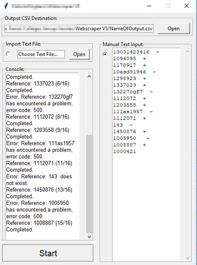
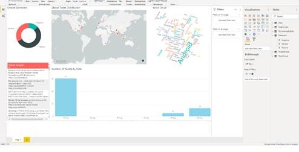

<!--
  Everything below is the owner's text from the old site
  (legacy/src/components/Experience/Professional/Jacobs.tsx), word for word
  apart from spelling fixes, for the owner to cut down (decision W-10). On the
  old site both paragraphs sat under the scraper's heading; the sentiment
  analysis text is now under its own.
-->

### Webscraping Tool

<ul class="tech-list" aria-label="Skills">
<li class="chip">Webscraping</li><li class="chip">Python</li><li class="chip">UI</li>
</ul>

I was asked to develop a tool that would scrape the data off websites from a single domain, each website uniquely identified by an ID, and condense it into an Excel spreadsheet (a CSV file) to ease the workload off my peers who would have otherwise manually gone through the websites and collected the data themselves. The frontend was a Tkinter-based GUI and the program reached a peak speed of 120 websites/minute, but was manually reduced to prevent overloading the server. This endeavor taught me how to use Python to parse HTML code and extract the necessary information as well as how to interface with CSV files. Additionally, I improved my skills on UI and UX design as ease of use remained a priority when developing this program.

[[CHECK: the web scraper is not on the CV; confirm you want it here]]

### Twitter Sentiment Analysis

<ul class="tech-list" aria-label="Skills">
<li class="chip">Twitter API</li><li class="chip">PowerBI</li><li class="chip">NLP</li><li class="chip">Big Data</li>
</ul>

I was asked to use Twitter's API to find how the public feels about a certain topic or keyword - the program would grab all tweets that contained this keyword and would analyse the 'sentiment' of the Tweet (either judging it to be positive, negative or neutral), and would record the results and information into a database. Using this information, I could deduct the public's overall feeling or 'sentiment' towards any one entity. The program was to be hosted on AWS. For the frontend, I was told to use Microsoft's PowerBI. This was my first encounter with any form of Natural Language Processing, PowerBI and Big Data (any one keyword could have millions of entries), and I quickly developed the skills required to work with them.

[[CHECK: the CV gives this as "a real-time NLP sentiment analysis dashboard using Python, the Twitter API, AWS, SQL and Power BI"; the detail above is from the old site]]

